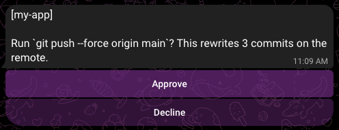
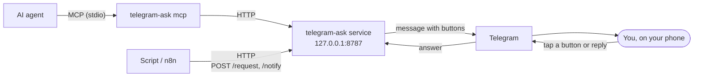

# telegram-ask

**Let your AI agents and scripts ask you before they act.** They send a question, it pops up on your phone in Telegram, you tap a button, and they get the answer back.



Good for an agent that wants to force-push, a deploy script that needs a go-ahead, or an n8n flow that just wants to tell you something. Runs on your machine, talks only to you.

## Quick start

You need Node 24+ and a bot token from [@BotFather](https://t.me/BotFather).

```
npx telegram-ask init
```

It asks for the token, installs the service and prints a pairing code like `ABCD-EFGH`. Send `/start ABCD-EFGH` to your bot (or open the link it prints) and you're paired.

Then give your agent the tools. For Claude Code:

```
claude mcp add telegram-ask -- telegram-ask mcp
```

Or try it from the shell:

```
telegram-ask test
```

`init` also makes an API token (see [Security](#security)). The CLI, `mcp` and the Node client read it from `~/.config/telegram-ask/token` on their own. An agent in a container can't see that file, so pass it in: `export TELEGRAM_ASK_TOKEN=$(cat ~/.config/telegram-ask/token)`, then add `-e TELEGRAM_ASK_TOKEN` (name only) to `docker run` or `podman run`. Putting the value on the command line would show it in `ps`.

## How it works



A small service runs in the background on localhost. Callers POST a question with button options; the bot sends it to you and the HTTP request stays open until you tap a button or (with `allowText`) reply with text, or the timeout fires, then returns your answer. Agents reach the same API through `telegram-ask mcp`, a stdio MCP server. Notifications work the same way but don't wait for an answer.

It's single owner: one Telegram user, proven by a pairing code. The service can run as a Podman Quadlet, a Docker Compose project or a plain systemd user service.

## Agents (MCP)

`telegram-ask mcp [--port N]` is a stdio MCP server with four tools that forward to the [HTTP API](#scripts-and-tools-http-api). `project_name` shows as `[name]` on the first line of the message, so you can tell which agent is asking.

`ask_for_permission` asks a question with buttons, a typed reply or both, and waits for the answer or the timeout:

| Param             | Type     | Required            | Notes                                                                                         |
| ----------------- | -------- | ------------------- | --------------------------------------------------------------------------------------------- |
| `project_name`    | string   | yes                 | Max 100 chars.                                                                                |
| `text`            | string   | yes                 | The question.                                                                                 |
| `format`          | string   | no                  | `plain` (default) or `markdown`; see [Formatting](#formatting).                               |
| `options`         | string[] | unless `allow_text` | Button labels, unique, max 64 chars each. May be empty with `allow_text`.                     |
| `allow_text`      | boolean  | no                  | Let the user type an answer by replying. Default false.                                       |
| `timeout_option`  | string   | yes                 | Answer returned on timeout. One of `options`, or with `allow_text` any answer up to 64 chars. |
| `timeout_seconds` | number   | no                  | Default 300, max 86400 (24 h); longer values are capped.                                      |

While a question waits, the server sends MCP progress notifications every 60 seconds. Claude Code aborts a silent stdio tool call after 30 minutes (`CLAUDE_CODE_MCP_TOOL_IDLE_TIMEOUT`); progress keeps it alive when Claude Code sends a progress token. I haven't verified that it does. If it doesn't, raise the per-server `timeout` in `.mcp.json` or use `ask_for_permission_in_background`.

It returns the answer as text (with `(timed out, no answer from the user)` appended on timeout) and as structured content `{ "answer": "...", "timed_out": false }`.

`ask_for_permission_in_background` takes the same params as `ask_for_permission` but returns as soon as the message is sent, for agents with other work to do first or a client that can't hold a long call. The text result is `Asked. Call wait_for_answer with request_id <id> when you need the answer (expires <time>).` and the structured content is `{ "request_id": "...", "expires_at": "2026-10-20T06:00:00.000Z" }`. `expires_at` is when the timeout fires (the timeout is capped at 24 h). A service older than this release has no background questions, and the tool says it's too old.

`wait_for_answer` collects the answer:

| Param          | Type   | Required | Notes                                                                                     |
| -------------- | ------ | -------- | ----------------------------------------------------------------------------------------- |
| `request_id`   | string | yes      | From `ask_for_permission_in_background`.                                                  |
| `wait_seconds` | number | no       | Max time to wait. Omit it to wait until the question settles; `0` checks once. Max 86400. |

It returns text plus structured content `{ "state": ..., "answer"?: ..., "timed_out"?: ... }`:

- answered or timed out: the same text as `ask_for_permission`, structured `{ "state": "done", "answer": "Approve", "timed_out": false }`.
- `wait_seconds` ran out first: `still waiting for the user`, structured `{ "state": "pending" }`.
- cancelled: `the question was cancelled`, structured `{ "state": "cancelled" }`. That's a normal result, not a tool error.

An answer stays readable for 24 h after the question settles. After that, or after a service restart, `wait_for_answer` returns an error saying the service doesn't know the request. It sends progress notifications the same way as `ask_for_permission`. Cancelling a `wait_for_answer` call only stops the wait; the question stays open and you can wait again.

Closing the agent session (the MCP server's stdin) cancels the background questions it asked that haven't been answered, and their Telegram messages get the cancelled line. If the MCP server is killed outright, they stay open until their timeout.

`notify_user` sends a message that doesn't need an answer and returns `sent` once Telegram accepts it:

| Param          | Type   | Required | Notes                                                           |
| -------------- | ------ | -------- | --------------------------------------------------------------- |
| `project_name` | string | yes      | Max 100 chars.                                                  |
| `text`         | string | yes      | The message.                                                    |
| `format`       | string | no       | `plain` (default) or `markdown`; see [Formatting](#formatting). |

Register it with Claude Code:

```
claude mcp add telegram-ask -- telegram-ask mcp
```

In a container or anywhere the package isn't installed, use `npx -y telegram-ask mcp` as the command. Other clients take the usual JSON:

```json
{
  "mcpServers": {
    "telegram-ask": { "command": "telegram-ask", "args": ["mcp"] }
  }
}
```

If the token file isn't readable where the MCP server runs (a container, another user), set `TELEGRAM_ASK_TOKEN` to its contents, which wins over the file. In a client's JSON, add an `env` block:

```json
{
  "mcpServers": {
    "telegram-ask": {
      "command": "telegram-ask",
      "args": ["mcp"],
      "env": {
        "TELEGRAM_ASK_TOKEN": "<contents of ~/.config/telegram-ask/token>"
      }
    }
  }
}
```

For a container, `export TELEGRAM_ASK_TOKEN=$(cat ~/.config/telegram-ask/token)` and then `-e TELEGRAM_ASK_TOKEN` (name only) does the same; a `-e NAME=value` would show the token in `ps`.

The port comes from `--port`, then `PORT`, then the install's `install.json`, then 8787. If you run `start` by hand on a custom port without an install, pass `--port` or set `PORT`.

The service has to be running. A call made while it's down returns an error to the agent; the MCP server stays up, so the next call works once the service is back.

`project` needs a service at least as new as this release. An older service sends the message without the project line, and `notify_user` reports that the service is too old. Re-run `init` to upgrade. `format` needs a service at least as new as the release that added it; an older one shows the markdown as typed.

## Claude Code hook

`telegram-ask hook` is a Claude Code hook command. It sends permission prompts to your phone and hands your tap back to Claude Code as the decision. It also forwards a few notifications (Claude is idle, needs input) as plain messages. Claude Code doesn't need to know about telegram-ask; it just runs the command.

Add this to `~/.claude/settings.json`, or to a project's `.claude/settings.json`:

```json
{
  "hooks": {
    "PermissionRequest": [
      {
        "hooks": [{ "type": "command", "command": "telegram-ask hook", "timeout": 360 }]
      }
    ],
    "Notification": [
      {
        "matcher": "idle_prompt|elicitation_dialog|agent_needs_input",
        "hooks": [{ "type": "command", "command": "telegram-ask hook" }]
      }
    ]
  }
}
```

Not verified yet: whether Claude Code shows the terminal dialog while the hook is still running. The supported flow is to answer on the phone, or tap `Ask in terminal` to hand the prompt back to the keyboard. If a terminal answer doesn't stop the hook, the question stays in Telegram until its timeout. `--timeout 120` shortens that.

The buttons:

| Button            | Effect                                                                                                                                                               |
| ----------------- | -------------------------------------------------------------------------------------------------------------------------------------------------------------------- |
| `Allow`           | Allows this one call.                                                                                                                                                |
| `Always allow`    | Allows it and adds the rule Claude Code suggests, the same as its "don't ask again" choice. Only shown when Claude Code offers one and the rule fits in the message. |
| `Deny`            | Denies the call.                                                                                                                                                     |
| `Ask in terminal` | Makes no decision, so Claude Code shows its normal prompt.                                                                                                           |

A timeout behaves like `Ask in terminal`. Long inputs that don't fit in the message offer only `Deny` and `Ask in terminal`. `AskUserQuestion` always stays in the terminal.

- `PermissionRequest` has no matcher in the snippet, so every prompt goes to the phone. To narrow it, add `"matcher": "Bash|Edit|Write"` to that entry.
- The `Notification` matcher leaves out `permission_prompt` on purpose. That notification fires a few seconds after a prompt appears, and the `PermissionRequest` hook has already asked.
- `timeout: 360` is the default 300 s wait, the 30 s HTTP grace and some slack, so Claude Code doesn't kill the hook before the service answers. If you pass a longer `--timeout`, the Claude Code hook `timeout` must be at least `--timeout` + 60.
- Without the package on `PATH`, use `npx -y telegram-ask hook` as the command. npx adds startup time to every prompt.
- `--project NAME` sets the `[name]` line. Default is the Claude Code project folder.
- `--timeout S` is how long to wait for a tap on a permission prompt. Default 300, max 86400 (24 h); longer values are capped.
- `--port N` picks the port as for [`mcp`](#agents-mcp), including `PORT`. Hooks inherit Claude Code's environment, so a `PORT` meant for your own app (say `PORT=3000`) points the hook at the wrong place. Pass `--port` then.
- It finds the API token the same way `mcp` and `send` do: `TELEGRAM_ASK_TOKEN`, else `~/.config/telegram-ask/token`.

It fails open. If the service is down or not paired, the hook does nothing and the terminal prompt works as usual. In `-p` (non-interactive) mode there's no terminal prompt, so no decision means Claude Code denies.

## Scripts and tools (HTTP API)

### From the shell

`telegram-ask send` wraps `/request` and `/notify` so scripts don't need curl:

```
answer=$(telegram-ask send request 'Deploy?' -o Approve -d Decline --timeout 60)
telegram-ask send notify 'backup finished' --project nas
telegram-ask send request $'Force-push `main`?' -o Yes -d No --format markdown
```

`send request` prints the answer on stdout (the `-d` default on timeout) and exits 0. `--json` prints `{"answer":"...","timedOut":false}` instead, if you need to tell a timeout from a tap. `-o` repeats once per button; `-d` adds the default as the last button unless an `-o` already names it. `--allow-text` also lets you answer by replying with text; then `-o` is optional and `-d` can be any short answer, not added as a button. `send notify` prints nothing and exits 0 once sent. `--format markdown` on either one reads the text as [markdown](#formatting). Errors go to stderr with exit 1, and bad arguments exit 2. Ctrl-C cancels a pending question, which edits the Telegram message to a "cancelled" line. The port is picked the same way as for [`mcp`](#agents-mcp).

### From Node

`npm i telegram-ask` and use the `Client`, which wraps the same two endpoints:

```ts
import { Client } from 'telegram-ask'

const client = new Client({ project: 'deploy' })
const { answer, timedOut } = await client.request({
  text: 'Deploy?',
  options: ['Approve', 'Decline'],
  timeoutOption: 'Decline',
  timeout: 60,
})
await client.notify({ text: 'backup finished' })
```

`new Client()` takes optional `host` (default `127.0.0.1`), `port` (default 8787), `token` and `project`, which every call sends unless it passes its own. Without `token`, each call looks one up: `TELEGRAM_ASK_TOKEN` if set, else the token file, else none is sent. An invalid `token` throws a `RangeError`. `request` takes the [`/request` fields](#ask-a-question) plus an optional `signal`, and `request` and `notify` take `format: 'markdown'` (see [Formatting](#formatting)). When you put untrusted text into a markdown message, `escapeMarkdown(text)` makes it show as typed and `formatCodeBlock(code, language?)` wraps code in a fence that can't be closed from inside. Both are exported from the package; aborting it cancels the question and rejects with the signal's reason. Failures (service down, a 400, a send error) throw a `TelegramAskError` with the same message the CLI prints. A timeout isn't a failure: it resolves with `timeoutOption` and `timedOut: true`.

### Ask a question

```
curl -s -X POST http://127.0.0.1:8787/request \
  -H 'content-type: application/json' \
  -H "authorization: Bearer $(cat ~/.config/telegram-ask/token)" \
  -d '{"text":"Deploy?","options":["Approve","Decline"],"timeoutOption":"Decline","timeout":60}'
```

The request stays open until you tap a button (or reply, see below) or the timeout fires, then returns `200`:

```json
{ "answer": "Approve", "timedOut": false }
```

On timeout, `answer` is `timeoutOption` and `timedOut` is `true`. If the owner sends `/cancel`, every open request returns its `timeoutOption` with `timedOut: false`. Many requests can be pending at once.

For a question with no sensible buttons, set `allowText` and leave out `options`; you answer by replying with text:

```
curl -s -X POST http://127.0.0.1:8787/request \
  -H 'content-type: application/json' \
  -H "authorization: Bearer $(cat ~/.config/telegram-ask/token)" \
  -d '{"text":"Which branch?","allowText":true,"timeoutOption":"main","timeout":120}'
```

Reply to the question's message in Telegram; if it's the only open text question, just typing works. The first answer wins, whether it's a tap or a reply. Non-text replies don't count, and a registered command name (`/pending`, `/cancel`, `/history`) can't be typed as an answer.

`allowText` needs a service at least as new as this release. An older one ignores it: with `options` you get a buttons-only question, without them a 400 `options must be a non-empty array`. Re-run `init` to upgrade.

`POST /request` body:

| Field           | Type     | Required           | Notes                                                                                                                   |
| --------------- | -------- | ------------------ | ----------------------------------------------------------------------------------------------------------------------- |
| `text`          | string   | yes                | Question shown in Telegram. Non-empty, max 3900 chars (with `markdown`, counted after the markup is removed).           |
| `allowText`     | boolean  | no                 | Default `false`. When true, a text reply from the owner answers the question.                                           |
| `options`       | string[] | unless `allowText` | Button labels. Non-empty, unique, non-empty strings. With `allowText`, may be omitted or `[]` for a text-only question. |
| `timeoutOption` | string   | yes                | Answer returned on timeout. Must be one of `options`; with `allowText`, any non-empty string up to 64 chars.            |
| `timeout`       | number   | no                 | Seconds. Default 300, max 86400 (24 h); longer values are capped. Must be positive.                                     |
| `project`       | string   | no                 | Shown as `[project]` on the first line. Trimmed, max 100 chars. Counts toward the 3900.                                 |
| `format`        | string   | no                 | `plain` (default) or `markdown`. See [Formatting](#formatting).                                                         |

The cap used to be 300, so a `timeout: 900` was clamped to 300 before and now waits the full 900 s.

Callers on Node's global `fetch` (undici, 300 s headers timeout) should keep `timeout` at 290 or less, raise `headersTimeout` with a custom dispatcher, or use [`POST /request/async`](#background-questions). curl, `node:http` and this package's CLI, `Client` and MCP server aren't affected.

Errors are JSON `{ "error": "..." }`:

| Status | Meaning                                                                                            |
| ------ | -------------------------------------------------------------------------------------------------- |
| 400    | Body isn't valid JSON or fails validation. Nothing is sent to Telegram.                            |
| 401    | Missing or wrong token.                                                                            |
| 413    | Body over 64 KiB.                                                                                  |
| 502    | Message couldn't be sent.                                                                          |
| 500    | Internal error, or the request was cancelled.                                                      |
| 404    | Path isn't `/request`, `/request/async`, `/request/{id}`, `/notify`, `/status` or `/openapi.yaml`. |
| 405    | Method isn't the one the path takes (POST, or GET and DELETE for `/request/{id}`).                 |

If the caller disconnects early, the request is dropped and the Telegram message is edited to a "cancelled" line. A restart still drops pending requests (callers see a connection error), but when the service comes back it edits their Telegram messages to an expired line.

### Background questions

`POST /request/async` takes the same body and sends the same message, but answers `202` as soon as it is sent, so no connection has to stay open. It checks pairing like `/request`; the routes below only need the token.

```
curl -s -X POST http://127.0.0.1:8787/request/async \
  -H 'content-type: application/json' \
  -H "authorization: Bearer $(cat ~/.config/telegram-ask/token)" \
  -d '{"text":"Deploy?","options":["Approve","Decline"],"timeoutOption":"Decline","timeout":3600}'
```

```json
{ "id": "6f1c...", "state": "pending", "expiresAt": "2026-10-19T12:00:00.000Z" }
```

The `Location` header is `/request/{id}`. `GET /request/{id}` returns the state: `pending` as above, `{ "id": "...", "state": "done", "answer": "Approve", "timedOut": false }` once settled, or `{ "id": "...", "state": "cancelled" }` after a cancel. Add `?wait=SECONDS` (max 120, larger values are clamped) to hold the request until the question settles or the time runs out; it returns the moment the question settles. Loop on it until `state` isn't `pending`. A `wait` that isn't a non-negative number is a `400`. Closing a long-poll doesn't cancel the question.

`DELETE /request/{id}` cancels a pending question (the Telegram message becomes a "cancelled" line) and returns its state, and a following `GET` agrees. On an already settled question it just returns that state. An unknown id answers `404` with `{ "error": "unknown request" }`. Settled questions are kept for 24 h.

Version skew: a service from before this release clamps `timeout` to 300 s and answers `404` to these paths, so a client that needs long timeouts should check the service version first (`info.version` in `GET /openapi.yaml`). A restart drops background questions (`404` afterwards), and their Telegram messages get the expired line on the next start.

### Send a notification

For messages that don't need an answer, e.g. from n8n when someone joins a game server:

```
curl -s -X POST http://127.0.0.1:8787/notify \
  -H 'content-type: application/json' \
  -H "authorization: Bearer $(cat ~/.config/telegram-ask/token)" \
  -d '{"text":"alice joined the Core Keeper server"}'
```

It returns `200 { "ok": true }` as soon as Telegram accepts the message. The message has a Dismiss button that deletes it, and it's deleted automatically after 8 hours. During [quiet hours](#quiet-hours) or a mute it's sent silently (no sound or buzz) and the 8 hours start when the quiet period ends.

`POST /notify` body:

| Field     | Type   | Required | Notes                                                                                                |
| --------- | ------ | -------- | ---------------------------------------------------------------------------------------------------- |
| `text`    | string | yes      | Shown in Telegram. Non-empty, max 3900 chars (with `markdown`, counted after the markup is removed). |
| `project` | string | no       | Shown as `[project]` on the first line. Trimmed, max 100 chars. Counts toward the 3900.              |
| `format`  | string | no       | `plain` (default) or `markdown`. See [Formatting](#formatting).                                      |

Errors are JSON `{ "error": "..." }`:

| Status | Meaning                                                                 |
| ------ | ----------------------------------------------------------------------- |
| 400    | Body isn't valid JSON or fails validation. Nothing is sent to Telegram. |
| 401    | Missing or wrong token.                                                 |
| 413    | Body over 64 KiB.                                                       |
| 501    | Notifications aren't supported.                                         |
| 502    | Message couldn't be sent.                                               |
| 503    | Not paired yet.                                                         |
| 405    | Method isn't POST.                                                      |
| 500    | Internal error.                                                         |

### Formatting

`format` is `plain` by default: the text is sent exactly as given. With `"format": "markdown"` a small subset is rendered and the markers are removed:

| Write                  | You see                                  |
| ---------------------- | ---------------------------------------- |
| `` `ls -la` ``         | `ls -la` in monospace                    |
| ` ```diff ` fence      | a monospace block (language is optional) |
| `**bold**`, `*italic*` | bold, italic                             |
| `~~old~~`              | strikethrough                            |
| `## Heading`           | the heading text in bold                 |
| `> quote`              | a quote block                            |

An agent can send this:

````
Force-push `feature/login` to origin?

```diff
-  return token
+  return token.trim()
```
````

and the owner sees the branch name in monospace and the diff as a monospace block, with the backticks gone.

Anything that isn't in the table stays as typed: lists, tables, links, images, HTML and `_underscores`. A marker that doesn't pair up, or sits inside a word (`2*3*4`, `snake_case`, `src/**/*.ts`), stays literal too, so a malformed message still arrives. Put a `\` before a marker to show it as is. Text inside code is never changed. To show a block that itself contains a fence, open it with a longer one (four backticks around three). Line breaks are kept as written.

The 3900 limit counts the text after the markup is removed, so the source may be longer. A message that renders to nothing but whitespace is a 400. Put commands in code: a glob like `ls *foo* bar` looks exactly like emphasis, and in markdown mode it would show as `ls foo bar` in italics.

If Telegram refuses the formatting, the service sends the message again as plain text (the rendered text, without the markers) and logs one line, so the question still gets through.

`format` needs a service at least as new as this release; an older one shows the markdown as typed. Re-run `init` to upgrade.

### Status

`GET /status` needs the token too. It returns `provider` and `displayName` along with `paired` and `bot`, plus `code` and `instructions` while unpaired. `telegram-ask status` is the friendlier way to read it.

### OpenAPI spec

The API is described in OpenAPI 3.1: [`docs/openapi.yaml`](docs/openapi.yaml) (port 8787, Telegram's text limit), `GET /openapi.yaml` on a running service, or `telegram-ask openapi [FILE]`. The last two use the install's port and its provider's text limit. Regenerate the docs copy with `npm run openapi`.

## Install options

Create a bot with @BotFather first and have the token ready. `init`:

1. Detects which targets work here (Podman Quadlet, Docker Compose, systemd) and asks where the bot should run. The first usable one in that order is the default. Or pass it: `init quadlet`, `init compose`, `init systemd`. `--provider NAME` picks the chat app; only `telegram` exists for now, and it's the default.
2. Asks for the bot token (input hidden) and checks it with Telegram. Port is 8787; use `--port N` to change it. It refuses a port that's already in use.
3. Makes an API token and saves it to `~/.config/telegram-ask/token` (mode 0600). It asks first if you're upgrading an install that has none; `--token` and `--no-token` skip the question. It reuses a valid saved token.
4. Installs and starts the service, then waits for pairing.

If it finds an existing install it offers to replace it, reusing the saved bot token and owner (no re-pairing). If there's no install but a bot token was kept by `uninstall`, it reuses that (and the owner) too. If `init` fails partway, run it again; the old install record and saved bot token are kept until the new install succeeds.

Node 24+ is needed for `npx` and the systemd target; the container targets bring their own Node.

The API token file `~/.config/telegram-ask/token` is written for every target; the service's own copy goes in the target's `.env` or in `config.json` as listed below. All targets keep their files under `~/.config/telegram-ask/` (or `$XDG_CONFIG_HOME/telegram-ask/`). `install.json` there records which target is installed, its port and version. It's what `status`, `reset-owner` and `uninstall` read.

### Podman Quadlet

Needs Podman 4.4 or newer and a systemd user session. Written:

- `~/.config/telegram-ask/quadlet/` with a `Dockerfile`, `.env` (bot token, port, owner, `TELEGRAM_ASK_TOKEN`) and a `.dockerignore` that keeps `.env` out of the image build
- `~/.config/containers/systemd/telegram-ask.container`
- image `localhost/telegram-ask:<version>`, volume `telegram-ask-data` (holds the pairing state and `state.json`)

Runs as a user service named `telegram-ask`. `init` enables linger (`loginctl enable-linger`) if needed so it survives logout; it tells you if that needs a password. Logs:

```
journalctl --user -u telegram-ask -f
```

### Docker Compose

Needs Docker with the compose v2 plugin, and your user in the `docker` group (otherwise `init` reports it can't talk to docker and skips this target). Written:

- `~/.config/telegram-ask/compose/` with `Dockerfile`, `compose.yaml`, `.env` (bot token, port, owner, `TELEGRAM_ASK_TOKEN`) and `.dockerignore`
- a named volume `data` in the `telegram-ask` compose project (holds the pairing state and `state.json`)

Logs:

```
docker compose -f ~/.config/telegram-ask/compose/compose.yaml logs -f
```

This target is untested on real Docker so far.

### systemd (npm)

No container. `init` installs the package globally with npm (`npm i -g`), or into `~/.local/share/telegram-ask/npm` if the global prefix isn't writable. If you ran `init` from an already-installed copy, it uses that. Written:

- `~/.config/telegram-ask/config.json` (bot token, port, owner, `apiToken`)
- `~/.config/telegram-ask/state.json` (pending requests and notification expiries, written by the service)
- `~/.config/systemd/user/telegram-ask.service` with absolute paths to `node`, the CLI and the config file (`TELEGRAM_ASK_CONFIG` is always set in the unit, and `install.json` records the same path)

Logs: `journalctl --user -u telegram-ask -f`. Linger is handled as for Quadlet.

### Config

Config is read from `$TELEGRAM_ASK_CONFIG`, else `$XDG_CONFIG_HOME/telegram-ask/config.json`, else `~/.config/telegram-ask/config.json`. The env vars `PROVIDER`, `BOT_TOKEN`, `OWNER_ID`, `PORT`, `HOST` and `TELEGRAM_ASK_TOKEN` override the file. `apiToken` in the file (or `TELEGRAM_ASK_TOKEN`) is the token the service requires; without either, the API is open. The same env var is what clients read, with the token file as their fallback. `PROVIDER` picks the chat app and defaults to `telegram`, which is the only one for now. `HOST` defaults to `127.0.0.1` (the container targets set `0.0.0.0` inside the container and publish only on `127.0.0.1`).

## Pairing

The first time (and after `reset-owner`), the bot only answers whoever proves they own it. `init` prints a code like `ABCD-EFGH` and a link. Either send `/start ABCD-EFGH` to your bot, or open `https://t.me/<bot>?start=ABCDEFGH`. Case and the dash don't matter. After 5 wrong codes from one Telegram user that user is blocked until the service restarts.

If you lose the code: `telegram-ask status` prints it again while unpaired.

To move to another Telegram account:

```
telegram-ask reset-owner
```

It asks first, clears the owner, restarts the service and waits for a new pairing.

## Bot commands

Send these to the bot in your private chat:

- `/pending` lists the open requests, with the time left and the answer each gets on timeout. A text question shows `or a typed reply` after its buttons, or `Typed reply` alone if it has none.
- `/cancel` rejects every open request with its `timeoutOption`.
- `/history [N]` shows the last N answers, newest first (default 10, max 20).
- `/mute [duration]`, `/unmute` and `/quiet` control [quiet hours](#quiet-hours).

Only the paired owner's private chat gets replies. History is kept in memory and resets on restart. A request that is still being sent when you run `/cancel` isn't rejected.

## Question log

The service keeps a log of every question and how it ended: answered, timed out, cancelled, or still open. Notifications aren't logged. `telegram-ask log` prints it, oldest first, newest at the bottom:

```
2026-10-19 00:41  deploy  Approve              Force-push main to origin?
2026-10-19 01:12  nas     Decline (timed out)  Delete 14 old snapshots?
2026-10-19 02:03          cancelled            Run migrations on prod?
2026-10-19 03:30  ci      interrupted          Merge #212?
```

The columns are the time asked (local), the project, the result and the first line of the question.

- `--since WHEN` shows questions asked at or after WHEN: a duration (`30m`, `12h`, `7d`), a local date (`2026-10-18`, meaning local midnight) or an ISO date-time.
- `--project NAME` matches the project name exactly.
- `-n N` (or `--limit N`) shows the last N. Without `--since` the default is 20; with `--since` you get all of them. An explicit `-n` always wins.
- `--json` prints one JSON object per line with the full text, the answer and both timestamps. For example, `telegram-ask log --since 7d --json | jq -r 'select(.status == "timedOut") | .text'`.

Statuses are `answered`, `rejected` (shown as `<answer> (rejected)`), `timedOut`, `cancelled`, `pending` (still waiting), `interrupted` (the service stopped before the question ended) and `expired` where the service recorded one. An outcome this version doesn't know is shown as is.

Where the log lives:

| Install                     | File                                                                      |
| --------------------------- | ------------------------------------------------------------------------- |
| systemd                     | `audit.jsonl` next to the config file, normally `~/.config/telegram-ask/` |
| Quadlet                     | `/data/audit.jsonl` in the `telegram-ask-data` volume                     |
| Compose                     | `/data/audit.jsonl` in the compose project's `data` volume                |
| no install, `start` by hand | next to `$TELEGRAM_ASK_CONFIG` or the default config path                 |

At 10 MiB the file rotates to `audit.jsonl.1`, and the old `.1` is dropped, so about two files' worth of history is kept. `log` reads both. To delete the log by hand:

```
rm -f ~/.config/telegram-ask/audit.jsonl*
podman exec telegram-ask rm -f /data/audit.jsonl /data/audit.jsonl.1
docker compose -f ~/.config/telegram-ask/compose/compose.yaml exec bot rm -f /data/audit.jsonl /data/audit.jsonl.1
```

`uninstall` removes the log only when you also purge the credentials. Installs from 0.4.0 or earlier don't keep a log; run `telegram-ask init` to upgrade, then `log` works.

## Quiet hours

Notifications can go out silently: they still show up in the chat, but without a sound or buzz. Approvals always ping, quiet or not, since an agent is blocked waiting on you.

| Command              | Effect                                                                     |
| -------------------- | -------------------------------------------------------------------------- |
| `/mute [duration]`   | Silence notifications from now. Default 1 hour. Replaces any earlier mute. |
| `/unmute`            | End the mute early. Quiet hours still apply.                               |
| `/quiet`             | Show the quiet hours, the time zone, the mute and whether it's silent now. |
| `/quiet 23:00-08:00` | Silence notifications every day in that window. It can wrap midnight.      |
| `/quiet off`         | Remove the quiet hours.                                                    |

A duration is `30m`, `2h`, `1d` or a combination in that order (`1h30m`, `1d12h`), at most `7d`. A bare number is rejected. Window times are 24-hour; `23-8` and `7:30-9` work too, and start and end can't be equal.

Both settings are saved in `config.json` as `quietHours` (`"23:00-08:00"`) and `mutedUntil` (an ISO timestamp), so they survive a restart. You can also edit them there; a hand edit applies on restart, and an invalid `quietHours` stops startup. When a mute passes, it just stops applying.

Windows use the service's own time zone, and replies that set or show a time name it. The systemd target uses the host's. `init` writes `TZ` into the Compose and Quadlet `.env` so the container matches the host. Container installs from before this release use UTC until you re-run `init`.

A notification sent while quiet is deleted 8 hours after the quiet period ends, not 8 hours after it was sent, so you get a chance to see it. If that would be more than 47 hours out (Telegram won't let a bot delete older messages), it isn't deleted automatically and stays until you dismiss it.

## Commands

```
telegram-ask init [systemd|compose|quadlet] [--port N] [--provider NAME] [--token|--no-token]
telegram-ask status
telegram-ask log [--since WHEN] [--project NAME] [-n N | --limit N] [--json]
telegram-ask test
telegram-ask reset-owner
telegram-ask uninstall
telegram-ask start
telegram-ask mcp [--port N]
telegram-ask hook [--port N] [--project NAME] [--timeout S]
telegram-ask openapi [FILE] [--port N]
telegram-ask send request TEXT [-o OPTION...] [--allow-text] -d DEFAULT [--timeout S] [--project NAME] [--format plain|markdown] [--json] [--port N]
telegram-ask send notify TEXT [--project NAME] [--format plain|markdown] [--port N]
```

- `init`: installs or replaces the service. See [Install options](#install-options).
- `status`: target, version, port, where the token comes from (never its value), whether it's running, and pairing state (with the code and instructions if unpaired).
- `log`: prints the questions the service asked and how they ended. See [Question log](#question-log).
- `test`: sends "This is a test" with Approve/Decline buttons (Decline on timeout) and prints the response.
- `reset-owner`: clears the paired owner. See [Pairing](#pairing).
- `uninstall`: stops and removes the service, then asks whether to also delete the saved credentials, API token, paired owner and question log. Answer no to keep them: `config.json` (systemd) or the target's `.env` and volume stay on disk, and a later `init` finds them and reuses the bot token and owner without asking. For systemd, `state.json` and the question log stay. The API token file `~/.config/telegram-ask/token` is kept too, and the next `init` reuses it. Yes also removes the target's image, volume and files (for systemd that includes `state.json` and `audit.jsonl`). For systemd the npm package stays; `uninstall` prints the command to remove it, `npm rm -g telegram-ask`, or `npm rm -g --prefix ~/.local/share/telegram-ask/npm telegram-ask` if `init` installed it into that prefix.
- `start`: runs the service in the foreground. The installed services use this.
- `mcp`: runs an MCP server on stdin/stdout so agents can ask and notify you. See [Agents (MCP)](#agents-mcp).
- `hook`: a Claude Code hook that sends permission prompts to Telegram. See [Claude Code hook](#claude-code-hook).
- `openapi`: prints the API's OpenAPI spec, or writes it to `FILE`. See [OpenAPI spec](#openapi-spec).
- `send request` / `send notify`: the HTTP API from a shell. See [From the shell](#from-the-shell).

### One instance per token

Only one instance can run per bot token; two would fight over Telegram's updates. `init` replaces an existing install rather than adding a second. Stop anything you started by hand, including a `docker run` container, before running `init`.

### Upgrading from the old setup

Earlier versions used `npm run onboard` and `deploy/install-service.sh`. `init` recognizes that systemd unit as a legacy install, offers to replace it, and reuses the bot token and owner from the existing config. Stop any hand-run Docker container using the same bot token first. The old config file is kept and reused if you pick the systemd target.

Re-running `init` on an install without an API token asks whether to add one (default yes). Once it's on, curl, n8n and container callers get a 401 until they send `authorization: Bearer <token>`; the CLI, `mcp` and the Node client pick it up on their own.

## Security

The API is meant for localhost only; don't expose it. The container targets publish the port on `127.0.0.1` only; keep it that way.

On top of that, `init` makes an API token and the service answers 401 without it. It stops other users on the machine, a browser page or a container that can reach the port from calling the API. It doesn't stop a process running as you: it can read `~/.config/telegram-ask/token` (mode 0600) like the CLI does. `init --no-token` turns it off, which leaves any local process able to ask or notify.

To rotate it, delete the token file and re-run `init`.

The [question log](#question-log) keeps question text and answers on disk (mode 0600, or inside the data volume). Agents sometimes put secrets in their questions, so treat the file like the other secrets under `~/.config/telegram-ask/`.

## Releasing

When a change matters to users, run `npm run changeset` on its branch, pick patch, minor or major, write a line or two for the changelog, and commit the generated `.changeset/*.md` file with the change. Internal changes (refactors, tests, docs) don't need one.

After a PR with a changeset is merged into `main`, the `publish` workflow opens or updates a `chore: release` PR that bumps the version, writes `CHANGELOG.md` and regenerates `docs/openapi.yaml`. Merging that PR is the release: the workflow runs the checks and tests, publishes to npm, pushes the `vX.Y.Z` tag and creates the GitHub Release. Nothing needs to be run locally.
