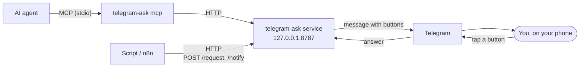

# telegram-ask

**Let your AI agents and scripts ask you before they act.** They send a question, it pops up on your phone in Telegram, you tap a button, and they get the answer back.


Good for an agent that wants to force-push, a deploy script that needs a go-ahead, or an n8n flow that just wants to tell you something. Runs on your machine, talks only to you.

## Quick start

You need Node 24+ and a bot token from [@BotFather](https://t.me/BotFather).

```
npx telegram-ask init
```

It asks for the token, installs the service and prints a pairing code like `ABCD-EFGH`. Send `/start ABCD-EFGH` to your bot (or open the link it prints) and you're paired.

Then give your agent the tools. For Claude Code:

```
claude mcp add telegram-ask -- telegram-ask mcp
```

Or try it from the shell:

```
telegram-ask test
```

## How it works



A small service runs in the background on localhost. Callers POST a question with button options; the bot sends it to you and the HTTP request stays open until you tap a button or the timeout fires, then returns your answer. Agents reach the same API through `telegram-ask mcp`, a stdio MCP server. Notifications work the same way but don't wait for an answer.

It's single owner: one Telegram user, proven by a pairing code. The service can run as a Podman Quadlet, a Docker Compose project or a plain systemd user service.

## Agents (MCP)

`telegram-ask mcp [--port N]` is a stdio MCP server with two tools that forward to the [HTTP API](#scripts-and-tools-http-api). `project_name` shows as `[name]` on the first line of the message, so you can tell which agent is asking.

`ask_for_permission` asks a question with buttons and waits for the tap or the timeout:

| Param             | Type     | Required | Notes                                                 |
| ----------------- | -------- | -------- | ----------------------------------------------------- |
| `project_name`    | string   | yes      | Max 100 chars.                                        |
| `text`            | string   | yes      | The question.                                         |
| `options`         | string[] | yes      | Button labels, unique, max 64 chars each.             |
| `timeout_option`  | string   | yes      | Answer returned on timeout. Must be one of `options`. |
| `timeout_seconds` | number   | no       | Default and max 300; longer values are capped to 300. |

It returns the answer as text (with `(timed out, no answer from the user)` appended on timeout) and as structured content `{ "answer": "...", "timed_out": false }`.

`notify_user` sends a message that doesn't need an answer and returns `sent` once Telegram accepts it:

| Param          | Type   | Required | Notes          |
| -------------- | ------ | -------- | -------------- |
| `project_name` | string | yes      | Max 100 chars. |
| `text`         | string | yes      | The message.   |

Register it with Claude Code:

```
claude mcp add telegram-ask -- telegram-ask mcp
```

In a container or anywhere the package isn't installed, use `npx -y telegram-ask mcp` as the command. Other clients take the usual JSON:

```json
{
  "mcpServers": {
    "telegram-ask": { "command": "telegram-ask", "args": ["mcp"] }
  }
}
```

The port comes from `--port`, then `PORT`, then the install's `install.json`, then 8787. If you run `start` by hand on a custom port without an install, pass `--port` or set `PORT`.

The service has to be running. A call made while it's down returns an error to the agent; the MCP server stays up, so the next call works once the service is back.

`project` needs a service at least as new as this release. An older service sends the message without the project line, and `notify_user` reports that the service is too old. Re-run `init` to upgrade.

## Scripts and tools (HTTP API)

### From the shell

`telegram-ask send` wraps `/request` and `/notify` so scripts don't need curl:

```
answer=$(telegram-ask send request 'Deploy?' -o Approve -o Decline --timeout-option Decline --timeout 60)
telegram-ask send notify 'backup finished' --project nas
```

`send request` prints the answer on stdout (the timeout option on timeout) and exits 0. `--json` prints `{"answer":"...","timedOut":false}` instead, if you need to tell a timeout from a tap. `-o` repeats once per button. `send notify` prints nothing and exits 0 once sent. Errors go to stderr with exit 1, and bad arguments exit 2. Ctrl-C cancels a pending question, which edits the Telegram message to a "cancelled" line. The port is picked the same way as for [`mcp`](#agents-mcp).

### From Node

`npm i telegram-ask` and use the `Client`, which wraps the same two endpoints:

```ts
import { Client } from 'telegram-ask'

const client = new Client({ project: 'deploy' })
const { answer, timedOut } = await client.request({
  text: 'Deploy?',
  options: ['Approve', 'Decline'],
  timeoutOption: 'Decline',
  timeout: 60,
})
await client.notify({ text: 'backup finished' })
```

`new Client()` takes optional `host` (default `127.0.0.1`), `port` (default 8787) and `project`, which every call sends unless it passes its own. `request` takes the [`/request` fields](#ask-a-question) plus an optional `signal`; aborting it cancels the question and rejects with the signal's reason. Failures (service down, a 400, a send error) throw a `TelegramAskError` with the same message the CLI prints. A timeout isn't a failure: it resolves with `timeoutOption` and `timedOut: true`.

### Ask a question

```
curl -s -X POST http://127.0.0.1:8787/request \
  -H 'content-type: application/json' \
  -d '{"text":"Deploy?","options":["Approve","Decline"],"timeoutOption":"Decline","timeout":60}'
```

The request stays open until you tap a button or the timeout fires, then returns `200`:

```json
{ "answer": "Approve", "timedOut": false }
```

On timeout, `answer` is `timeoutOption` and `timedOut` is `true`. Many requests can be pending at once.

`POST /request` body:

| Field           | Type     | Required | Notes                                                                                   |
| --------------- | -------- | -------- | --------------------------------------------------------------------------------------- |
| `text`          | string   | yes      | Question shown in Telegram. Non-empty, max 3900 chars.                                  |
| `options`       | string[] | yes      | Button labels. Non-empty, unique, non-empty strings.                                    |
| `timeoutOption` | string   | yes      | Answer returned on timeout. Must be one of `options`.                                   |
| `timeout`       | number   | no       | Seconds. Default and max 300. Must be positive.                                         |
| `project`       | string   | no       | Shown as `[project]` on the first line. Trimmed, max 100 chars. Counts toward the 3900. |

Errors are JSON `{ "error": "..." }`:

| Status | Meaning                                                                 |
| ------ | ----------------------------------------------------------------------- |
| 400    | Body isn't valid JSON or fails validation. Nothing is sent to Telegram. |
| 413    | Body over 64 KiB.                                                       |
| 502    | Message couldn't be sent.                                               |
| 500    | Internal error, or the request was cancelled.                           |
| 404    | Path isn't `/request`, `/notify`, `/status` or `/openapi.yaml`.         |
| 405    | Method isn't POST.                                                      |

If the caller disconnects early, the request is dropped and the Telegram message is edited to a "cancelled" line. Pending requests live in memory, so a restart drops them (callers see a connection error).

### Send a notification

For messages that don't need an answer, e.g. from n8n when someone joins a game server:

```
curl -s -X POST http://127.0.0.1:8787/notify \
  -H 'content-type: application/json' \
  -d '{"text":"alice joined the Core Keeper server"}'
```

It returns `200 { "ok": true }` as soon as Telegram accepts the message. The message has a Dismiss button that deletes it, and it's deleted automatically after 8 hours.

`POST /notify` body:

| Field     | Type   | Required | Notes                                                                                   |
| --------- | ------ | -------- | --------------------------------------------------------------------------------------- |
| `text`    | string | yes      | Shown in Telegram. Non-empty, max 3900 chars. Plain text.                               |
| `project` | string | no       | Shown as `[project]` on the first line. Trimmed, max 100 chars. Counts toward the 3900. |

Errors are JSON `{ "error": "..." }`:

| Status | Meaning                                                                 |
| ------ | ----------------------------------------------------------------------- |
| 400    | Body isn't valid JSON or fails validation. Nothing is sent to Telegram. |
| 413    | Body over 64 KiB.                                                       |
| 501    | Notifications aren't supported.                                         |
| 502    | Message couldn't be sent.                                               |
| 503    | Not paired yet.                                                         |
| 405    | Method isn't POST.                                                      |
| 500    | Internal error.                                                         |

Known issue: the 8-hour timers live in memory. If the service restarts before a notification's 8 hours are up, that message stays in the chat until you dismiss it (Dismiss still works after a restart).

### Status

`GET /status` returns `provider` and `displayName` along with `paired` and `bot`, plus `code` and `instructions` while unpaired. `telegram-ask status` is the friendlier way to read it.

### OpenAPI spec

The API is described in OpenAPI 3.1: [`docs/openapi.yaml`](docs/openapi.yaml) (port 8787, Telegram's text limit), `GET /openapi.yaml` on a running service, or `telegram-ask openapi [FILE]`. The last two use the install's port and its provider's text limit. Regenerate the docs copy with `npm run openapi`.

## Install options

Create a bot with @BotFather first and have the token ready. `init`:

1. Detects which targets work here (Podman Quadlet, Docker Compose, systemd) and asks where the bot should run. The first usable one in that order is the default. Or pass it: `init quadlet`, `init compose`, `init systemd`. `--provider NAME` picks the chat app; only `telegram` exists for now, and it's the default.
2. Asks for the bot token (input hidden) and checks it with Telegram. Port is 8787; use `--port N` to change it. It refuses a port that's already in use.
3. Installs and starts the service, then waits for pairing.

If it finds an existing install it offers to replace it, reusing the saved token and owner (no re-pairing). If there's no install but a token was kept by `uninstall`, it reuses that (and the owner) too. If `init` fails partway, run it again; the old install record and saved token are kept until the new install succeeds.

Node 24+ is needed for `npx` and the systemd target; the container targets bring their own Node.

All targets keep their files under `~/.config/telegram-ask/` (or `$XDG_CONFIG_HOME/telegram-ask/`). `install.json` there records which target is installed, its port and version. It's what `status`, `reset-owner` and `uninstall` read.

### Podman Quadlet

Needs Podman 4.4 or newer and a systemd user session. Written:

- `~/.config/telegram-ask/quadlet/` with a `Dockerfile`, `.env` (token, port, owner) and a `.dockerignore` that keeps `.env` out of the image build
- `~/.config/containers/systemd/telegram-ask.container`
- image `localhost/telegram-ask:<version>`, volume `telegram-ask-data` (holds the pairing state)

Runs as a user service named `telegram-ask`. `init` enables linger (`loginctl enable-linger`) if needed so it survives logout; it tells you if that needs a password. Logs:

```
journalctl --user -u telegram-ask -f
```

### Docker Compose

Needs Docker with the compose v2 plugin, and your user in the `docker` group (otherwise `init` reports it can't talk to docker and skips this target). Written:

- `~/.config/telegram-ask/compose/` with `Dockerfile`, `compose.yaml`, `.env` and `.dockerignore`
- a named volume `data` in the `telegram-ask` compose project

Logs:

```
docker compose -f ~/.config/telegram-ask/compose/compose.yaml logs -f
```

This target is untested on real Docker so far.

### systemd (npm)

No container. `init` installs the package globally with npm (`npm i -g`), or into `~/.local/share/telegram-ask/npm` if the global prefix isn't writable. If you ran `init` from an already-installed copy, it uses that. Written:

- `~/.config/telegram-ask/config.json` (token, port, owner)
- `~/.config/systemd/user/telegram-ask.service` with absolute paths to `node`, the CLI and the config file (`TELEGRAM_ASK_CONFIG` is always set in the unit, and `install.json` records the same path)

Logs: `journalctl --user -u telegram-ask -f`. Linger is handled as for Quadlet.

### Config

Config is read from `$TELEGRAM_ASK_CONFIG`, else `$XDG_CONFIG_HOME/telegram-ask/config.json`, else `~/.config/telegram-ask/config.json`. The env vars `PROVIDER`, `BOT_TOKEN`, `OWNER_ID`, `PORT` and `HOST` override the file. `PROVIDER` picks the chat app and defaults to `telegram`, which is the only one for now. `HOST` defaults to `127.0.0.1` (the container targets set `0.0.0.0` inside the container and publish only on `127.0.0.1`).

## Pairing

The first time (and after `reset-owner`), the bot only answers whoever proves they own it. `init` prints a code like `ABCD-EFGH` and a link. Either send `/start ABCD-EFGH` to your bot, or open `https://t.me/<bot>?start=ABCDEFGH`. Case and the dash don't matter. After 5 wrong codes from one Telegram user that user is blocked until the service restarts.

If you lose the code: `telegram-ask status` prints it again while unpaired.

To move to another Telegram account:

```
telegram-ask reset-owner
```

It asks first, clears the owner, restarts the service and waits for a new pairing.

## Commands

```
telegram-ask init [systemd|compose|quadlet] [--port N] [--provider NAME]
telegram-ask status
telegram-ask test
telegram-ask reset-owner
telegram-ask uninstall
telegram-ask start
telegram-ask mcp [--port N]
telegram-ask openapi [FILE] [--port N]
telegram-ask send request TEXT -o OPTION... --timeout-option OPTION [--timeout S] [--project NAME] [--json] [--port N]
telegram-ask send notify TEXT [--project NAME] [--port N]
```

- `init`: installs or replaces the service. See [Install options](#install-options).
- `status`: target, version, port, whether it's running, and pairing state (with the code and instructions if unpaired).
- `test`: sends "This is a test" with Approve/Decline buttons (Decline on timeout) and prints the response.
- `reset-owner`: clears the paired owner. See [Pairing](#pairing).
- `uninstall`: stops and removes the service, then asks whether to also delete the saved credentials and paired owner. Answer no to keep them: `config.json` (systemd) or the target's `.env` and volume stay on disk, and a later `init` finds them and reuses the token and owner without asking. Yes also removes the target's image, volume and files. For systemd the npm package stays; `uninstall` prints the command to remove it, `npm rm -g telegram-ask`, or `npm rm -g --prefix ~/.local/share/telegram-ask/npm telegram-ask` if `init` installed it into that prefix.
- `start`: runs the service in the foreground. The installed services use this.
- `mcp`: runs an MCP server on stdin/stdout so agents can ask and notify you. See [Agents (MCP)](#agents-mcp).
- `openapi`: prints the API's OpenAPI spec, or writes it to `FILE`. See [OpenAPI spec](#openapi-spec).
- `send request` / `send notify`: the HTTP API from a shell. See [From the shell](#from-the-shell).

### One instance per token

Only one instance can run per bot token; two would fight over Telegram's updates. `init` replaces an existing install rather than adding a second. Stop anything you started by hand, including a `docker run` container, before running `init`.

### Upgrading from the old setup

Earlier versions used `npm run onboard` and `deploy/install-service.sh`. `init` recognizes that systemd unit as a legacy install, offers to replace it, and reuses the token and owner from the existing config. Stop any hand-run Docker container using the same token first. The old config file is kept and reused if you pick the systemd target.

## Security

There's no auth. The API is meant for localhost only; don't expose it. The container targets publish the port on `127.0.0.1` only; keep it that way.
